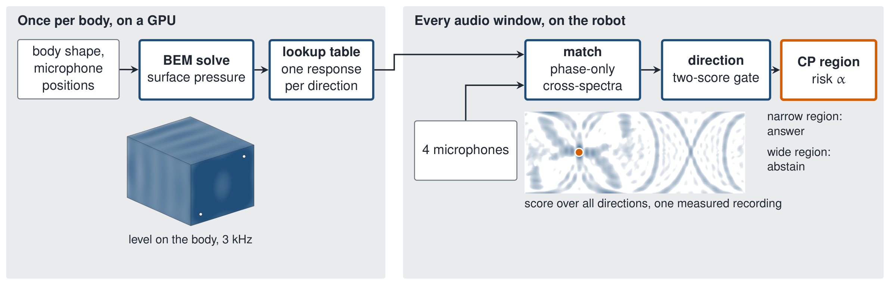

# Robot Body Sound Localization

Finds the azimuth and elevation of a speaker with four microphones on a robot body. The body scatters the sound before it reaches the microphones, so free-field methods and networks trained without that scattering lose accuracy on the robot. Here the microphone responses are computed from the body's shape and matched to the recording, with no training. Research internship at the KIST AI and Robotics Institute, Humanoid Research Center (2026).



## Microphone responses computed from the body's shape

`bem/make_table.py` computes the sound pressure on the body surface with the boundary element method on a GPU, once per body and microphone layout, and stores one response per direction. A new body needs a new table, not new training. A later version of this solver is released as [stl2bem](https://github.com/Kwon-Junhyeong/stl2bem); it takes any closed STL mesh and runs on the CPU or GPU.

## Matching with a confidence gate

`doa/matcher.py` scores every direction in the table against the phase-only cross-spectra of the four microphones. It returns a direction only when the phase closure of the four microphones and the prominence of the peak both meet their thresholds, and abstains otherwise.

## Conformal prediction

`doa/conformal.py` turns the score map into a region built to contain the true direction with probability 1 - alpha. Each task sets its own risk level alpha. When the noise or the room changes, adaptive conformal prediction updates alpha after each answer, based on whether the region contained the true direction. A narrow region is passed on as an answer and a wide one is withheld. Withholding the widest 20% of regions lowered the share of answers more than 5 degrees off from 12% to 2.6%.

## Results

On 4,000 simulated reverberant recordings of 0.5 s, 87.2% of the direction estimates are within 5 degrees, against 50.6% with a free-field table. With 1.0 s of audio the mean error is 1.23 degrees. On a 3D-printed test body, a source at 90 degrees is found at 89 degrees.

## Run

```sh
pip install -r requirements.txt
python bem/make_table.py                     # set the body and microphones at the top; writes h_table.npz
python locate.py h_table.npz RECORDING.wav   # 16 kHz, 4 channels
```
