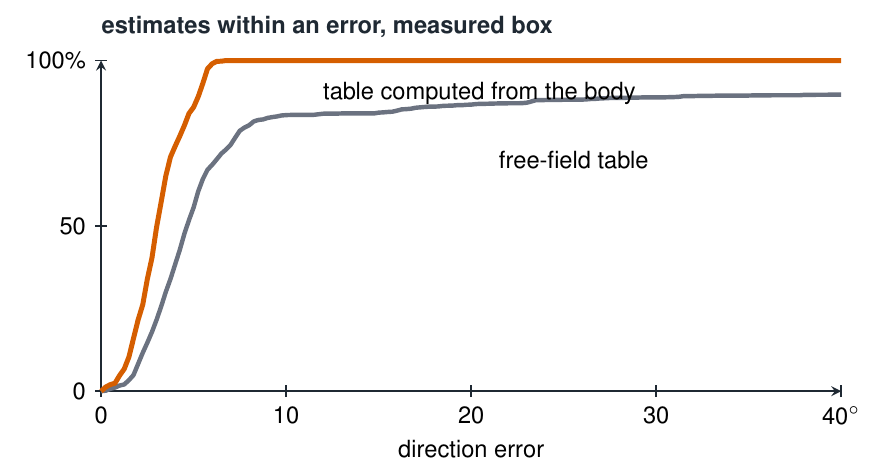

# Robot Body Sound Localization

Finds the direction of a speaker with four microphones on a robot body. The body scatters the sound before it reaches the microphones, so free-field methods lose accuracy on the robot. Here the microphone responses come from a boundary element model of the body and are used twice: to localize with SRP-PHAT, and to synthesize the audio that networks are trained on. Research internship at the KIST AI and Robotics Institute, Humanoid Research Center (2026).


## SRP-PHAT with the body's responses

`srp/build_lookup.py` turns a BEM table into templates: for every direction, the unit cross-spectra of the six microphone pairs. `srp/srp_mag_aware.py` scores every direction against the cross-spectra of the recording, and the estimate is the peak over the 48 strongest frames. Nothing is trained. The matcher can also score the level differences between the microphones, which the body's shadow creates; the results below use the phase score alone.

The BEM tables come from an earlier version of [stl2bem](https://github.com/Kwon-Junhyeong/stl2bem). The matcher that uses microphone-pair ratios is in [calibration-free-sound-localization](https://github.com/Kwon-Junhyeong/calibration-free-sound-localization).

## Training audio through the body

`synthesis/generate_data.py` writes one-second, four-channel scenes with their true directions: LibriSpeech speech in a random room, with a reverberation time of 0.2 to 1.3 s and diffuse NOISEX-92 noise at -5 to 15 dB SNR. The room is simulated with image sources, and every image source passes through the body's response for its own arrival direction (`synthesis/reverb_synth.py`), so the reflections are scattered by the body as well as the direct sound. The same scenes with a free-field table of the same microphones give the comparison data.

## Results

On a 3D-printed box with four microphones, recorded from 264 directions (2,437 one-second windows), the median error is 3.0 degrees with the body's templates, and no estimate is more than 30 degrees off. With free-field templates of the same microphones the median is 4.6 degrees, and 11% of the estimates are more than 30 degrees off. Nothing was trained or tuned on these recordings.



## Run

```sh
pip install -r requirements.txt
python srp/build_lookup.py BEM_TABLE.h5 templates.npz
python locate.py templates.npz RECORDING.wav          # 16 kHz, 4 channels
python synthesis/generate_data.py --bem_dir TABLES --libri_root LIBRISPEECH --noise_dir NOISEX92 --out_dir OUT
```

The BEM tables, the recordings and the speech and noise corpora are not part of the repository.
